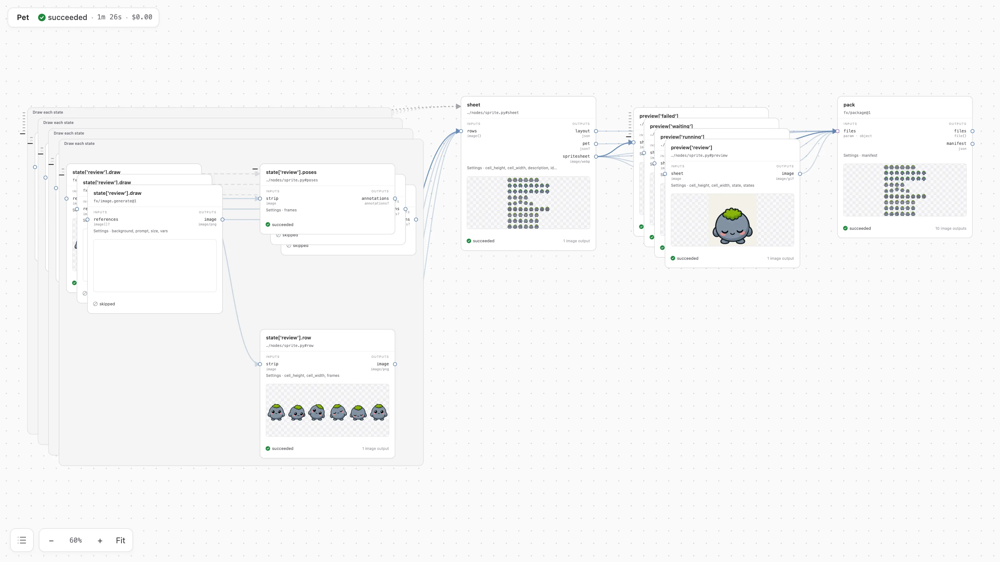

# FX

**Go with the flow.**



A workflow engine for images, audio, video, 3D and the code around them.

## Why FX

A build system for generated assets.

- **Priced before it spends.** The whole run is priced up front, and a live run reserves each call
  against its ceiling before making it.
- **Reuse completed work.** FX caches results and paid calls by content and saves progress
  so you can pause and resume a run.
- **Review and revisit results.** Pick an image in the viewer or supply a typed value from a
  script. Rerun under the same run ID and open any recorded attempt from its history.
- **Any model, or your own subscription.** Switch providers per step, or draw on your Codex or
  Grok plan.
- **One native engine.** No Docker, no server: YAML in git, from your laptop to CI.

## Install

```sh
npm install -g grida     # FX as `grida fx` (Node.js 24+; macOS, Linux, Windows through WSL 2)
pip install grida        # the Python SDK, for nodes in Python
npm install @grida/fx    # the TypeScript SDK, for nodes in TypeScript
```

For a pinned executable in CI, see [Standalone downloads](docs/guide/17-standalone-downloads.md).
For other installation options, see [Ways to run FX](CONTRIBUTING.md#ways-to-run-fx).

## AI providers

FX runs your own code with no provider at all. For AI steps, pick a route per capability or per
step, and mix them freely:

| | Set up | You get |
|---|---|---|
| **No provider** | nothing | your own code, cached and recorded |
| **BYOA** (bring your own agent) | Codex or Grok Build, signed in | images on your ChatGPT or Grok subscription, $0 to FX |
| **Provider keys** | `OPENAI_API_KEY`, `OPENROUTER_API_KEY`, `FAL_KEY`, `TRIPO_API_KEY`, `ELEVENLABS_API_KEY` | each provider's models, on its own account |
| **Grida Gateway** | `GG_API_KEY` | text, images, video and 3D with one key and one bill |

[AI providers](docs/guide/13-providers.md) says what each one serves and where to get each key.
For a selected missing GG or OpenRouter image binding, FX can look up model metadata without
generating or spending. A compatible model can plan with unknown cost; available shipped,
authored or discovered pricing improves the forecast. Use `--require-estimates` when forecast
coverage is required. Execution still requires approval and a run ceiling; unknown-cost calls
reserve remaining applicable budget and keep unreported charges separate from actual cost.
Other models FX does not list run from a route of your own; a provider FX does not ship, from a
declaration in `fx.yaml` and, unless it speaks OpenAI's chat API, an adapter of your own in Python
or TypeScript ([Community providers](docs/guide/15-community-providers.md)).

## Plan. Run. Inspect.

Start a project, then pick a route for its first workflow in `fx.yaml`:

```sh
npx grida fx init my-assets                  # a starter project, with files for coding agents
cd my-assets
grida fx start --background                  # the local viewer
grida fx plan icon --open                    # the steps and their price; spends nothing
grida fx run icon --name first-pass --live --max-usd 1 --open
```

Without `--live`, local steps run and FX reuses cached results. Open **Run actions** in the
viewer to pause, resume, or cancel a run. Rerunning makes a new attempt and keeps earlier
attempts available in history. If resuming or rerunning needs spending approval, the
viewer points you to the CLI. See [Run control](docs/guide/08-run-control.md) and
[Rerun and inspect earlier attempts](docs/guide/05-running.md#rerun-and-inspect-earlier-attempts).
Start with [the guide](docs/guide/01-getting-started.md) or the [examples](examples/).

Use `grida fx add pet` to copy an editable example into your workspace. Public GitHub templates
use `grida fx add OWNER/REPO@REF` with a tag or full commit SHA. For a private template, add
`--github-auth` to use your existing GitHub CLI authentication.
[Start from a template](docs/guide/01-getting-started.md#start-from-a-template)

### For agents

```sh
npx skills add gridaco/fx
```

[`llms.txt`](llms.txt) is the concise reference for agents, with runnable recipes checked against
the engine and links to the detailed guides.

## Learn more

- [The guide](docs/guide/README.md): workflows, nodes, cost and cache, running, viewing, sharing
- [Python SDK](python/README.md) and [JavaScript SDK](js/fx/README.md)
- [Specifications](spec/): the language-neutral contracts
- [Changelog](CHANGELOG.md)

## Contribute

See [CONTRIBUTING.md](CONTRIBUTING.md) for source builds and checks, and
[the overview](docs/wg/overview.md) for the project's direction. FX is open source under
[Apache-2.0](LICENSE).
