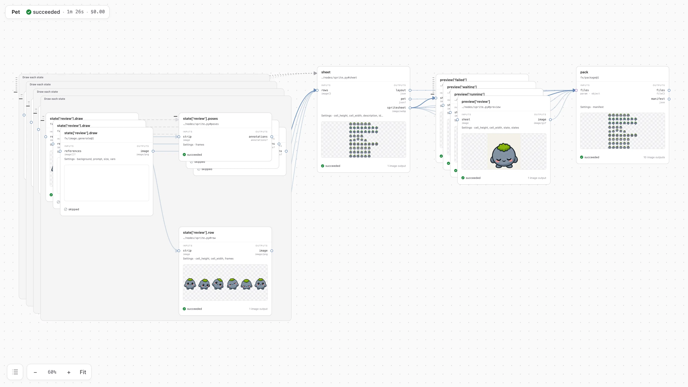

# Grida FX

**Go with the flow.**



Reusable workflows for images, audio, and more. Connect your code and AI models with one
Grida Gateway key (or your own provider keys), and turn a one-off script into something you can
run again.

- **See the plan first.** Inspect the steps, dependencies, and estimated cost before a paid run.
- **Keep the work you already did.** Reuse matching results from the cache and resume interrupted runs.
- **Look inside a run.** Open the node canvas to explore steps, connections, and recorded artifacts.
- **Test without a bill.** Run ordinary code offline, or use [stand-ins](docs/guide/05-running.md#stand-ins-testing-without-a-provider)
  to answer paid calls in tests.

## Install

FX comes with the Grida CLI:

```sh
npm install -g grida
grida fx --version
```

The CLI needs Node.js 24 or later and carries the FX version it was released with, so updating
`grida` updates FX. FX runs on macOS, and on Linux (x64 and arm64) with glibc 2.28 or later; on
Windows, use WSL 2.

Write custom nodes and builders in Python with the Python SDK:

```sh
pip install grida
```

The JavaScript SDK is `@grida/fx`. To run FX without the Grida CLI (in a service you host, say),
see [ways to run FX](CONTRIBUTING.md#ways-to-run-fx).

## AI providers

FX runs your own code with no provider at all. When a step calls an AI model, pick how it reaches
one:

| | What you set up | What you get |
|---|---|---|
| **No provider** | nothing | a plain workflow engine: your own code, cached and recorded |
| **Your own Codex** | Codex, signed in to ChatGPT | images, free to FX: Codex counts them against your plan |
| **Your own keys** | `OPENAI_API_KEY`, `FAL_KEY`, `TRIPO_API_KEY`, `ELEVENLABS_API_KEY`, … | each provider's models, on each provider's account |
| **Grida Gateway** | one `GG_API_KEY` | every modality, with one key and one bill |

[Grida Gateway](https://console.grida.co/_/ai-gateway) is the shortest way in: create a key,
set `GG_API_KEY` in the environment or a project `.env`, and FX's text, image, video and 3D steps
run on it. Mix paths as you like; [AI providers](docs/guide/13-providers.md) lists what each one
serves and where to get each key.

## Plan. Run. Inspect.

Start a project, then pick a route for its first workflow in `fx.yaml`:

```sh
npx grida fx init my-assets
cd my-assets
grida fx start --background
grida fx plan icon --open
grida fx run icon --live --max-usd 1 --open
```

`init` writes a starter project into an empty folder: a README that walks through installing
and connecting a provider, an `AGENTS.md` and the FX skills for coding agents, and a first
workflow. Or start from an example: `npx grida fx init my-assets --template pet`
(`--list-templates` lists them). FX keeps a
project dashboard and records every run.

A run without `--live` executes local steps and reuses cached results. New provider calls need
`--live` and a spending ceiling, such as `--max-usd 5`, unless every one is on your own Codex.

Start with [the guide](docs/guide/01-getting-started.md), or explore the
[examples](examples/): recolor an image with code, build a looping background,
or compose a concept gallery.

### For agents

Install the skill for workflow authoring, execution, and inspection:

```sh
npx skills add gridaco/fx
```

## Learn more

- [The guide](docs/guide/README.md): workflows, nodes, cost and cache, running, viewing, sharing
- [Python SDK](python/README.md) and [JavaScript SDK](js/fx/README.md)
- [Specifications](spec/): the language-neutral contracts

## Contribute

See [CONTRIBUTING.md](CONTRIBUTING.md) for source builds, examples, checks, and
viewer or website development. [The overview](docs/wg/overview.md) records the
project's history and direction; [ISSUES.md](ISSUES.md) tracks known gaps.

Grida FX is open source under [Apache-2.0](LICENSE).
